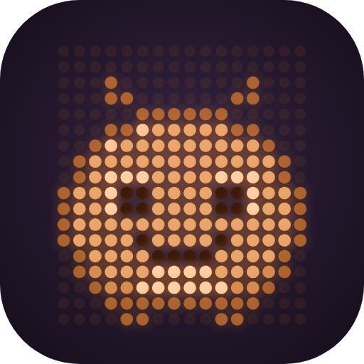
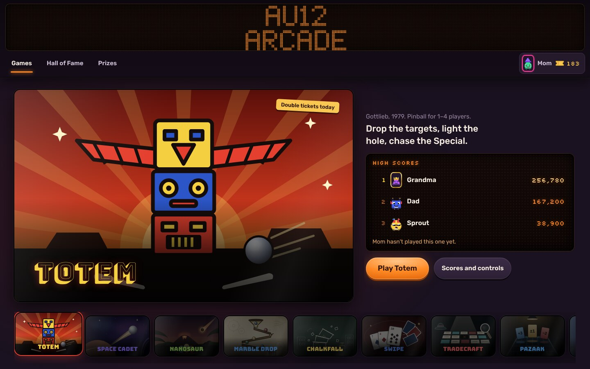
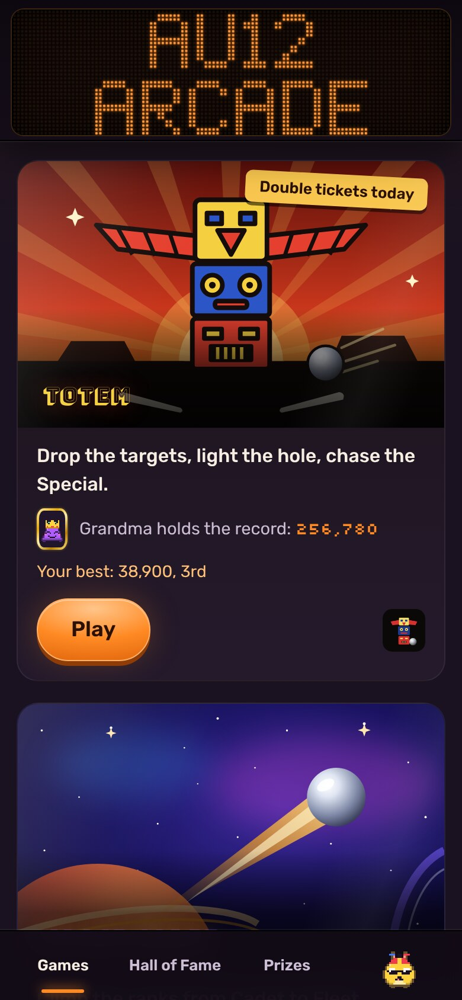
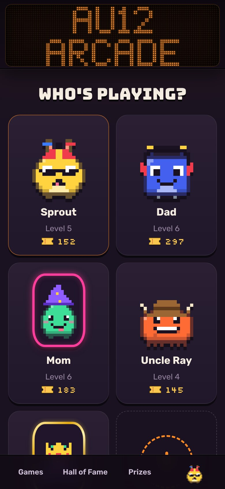
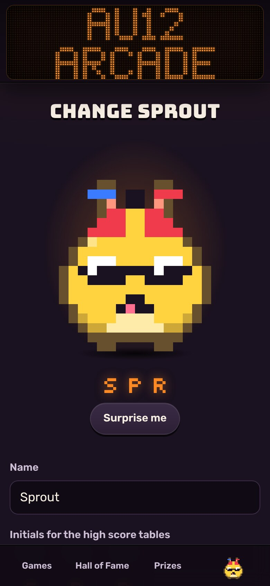
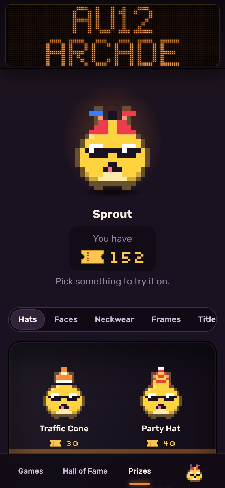
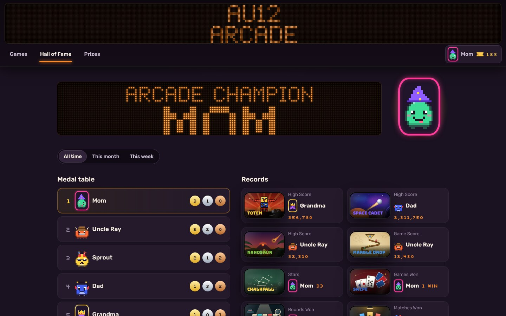
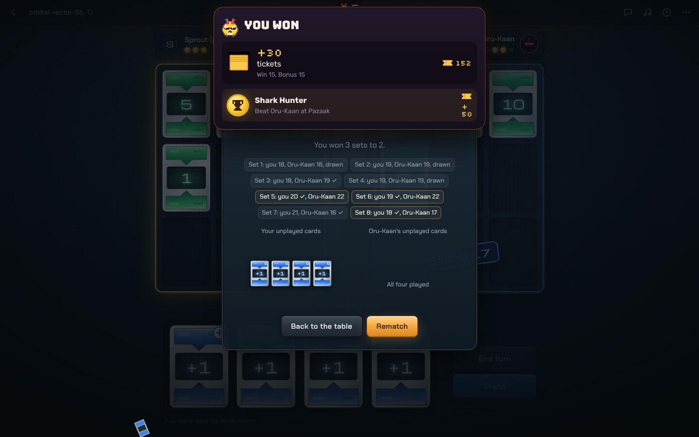
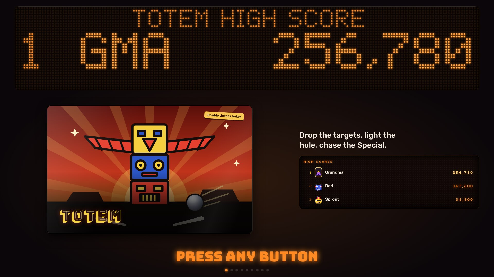
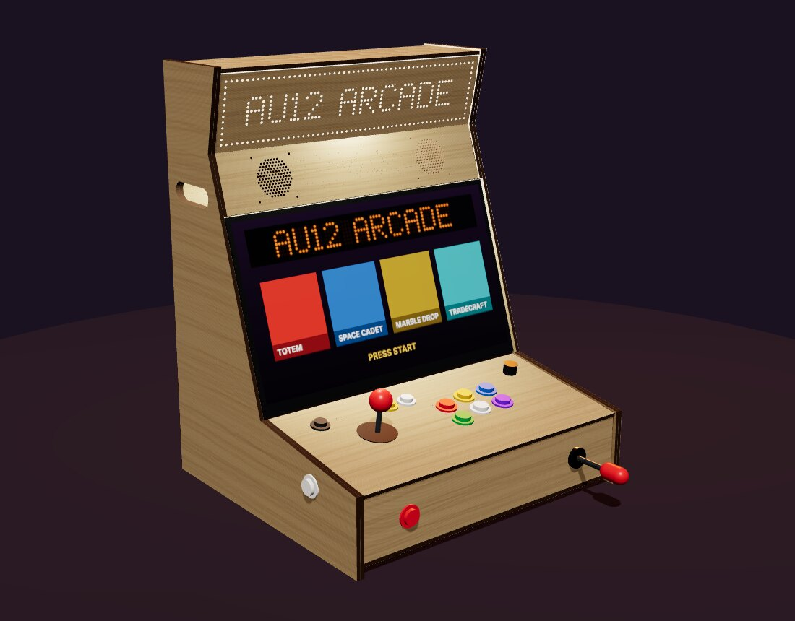

<p align="center"></p>

# au12 Arcade

One arcade for a shelf of self-hosted browser games. Totem and Space Cadet pinball, Nanosaur, Marble Drop, Chalkfall, Swipe, Tradecraft and Pazaak each run on their own subdomain; the arcade puts them behind a single installable app, with one set of family players, high scores and records across every game, tickets to spend at a prize counter, and achievements. Then it runs on a laser-cut bartop cabinet, in kiosk mode, with a real stick, buttons, flipper buttons and a spring plunger for the pinball tables.



<p align="center">




</p>

## What it does

- **Players, not accounts.** Everyone in the family picks a pixel critter (six genes, sixteen colors) and three initials for the high score tables. A device remembers who plays on it; a PIN (four to six digits) keeps a sibling from playing as you, if you want one.
- **Every game's scores in one place.** Each game reports its scores or its wins through a small SDK. The arcade keeps the boards (all time, this month, this week), spots personal bests and new records, and announces records on its dot-matrix display, live, on every screen that's open.
- **Tickets and a prize counter.** Scores and wins earn tickets (double on the game of the day, a bonus for records and a daily visit); tickets buy hats, faces, neckwear, frames and titles for your critter. Levels come with lifetime tickets.
- **Achievements**, across the arcade (*Tourist*: play four different games; *Night Owl*; *Family Game Night*) and inside each game (*Shark Hunter*: beat Oru-Kaan at Pazaak).
- **A Hall of Fame**: a medal table across all the games, and every record holder.
- **Installable**, and at home on a phone, a laptop, a TV or a cabinet: the same app, laid out for each, driven by touch, mouse, keyboard, a gamepad or the cabinet's controls.
- **Kiosk mode** for the cabinet: an attract loop with the high scores on the marquee, "still playing?" when a game sits idle, and the controller's buttons remapped for each game.
- **An admin page** for the game addresses, players (merge, rename, tickets), score corrections, and backups.







## The games

| Game | Repository | What it reports |
| --- | --- | --- |
| Totem | [au12/totem](https://github.com/au12/totem) | Each game's score |
| Space Cadet | [au12/spacecadet-web](https://github.com/au12/spacecadet-web) | Each game's score |
| Nanosaur | [au12/nanosaur-mobile](https://github.com/au12/nanosaur-mobile) | Each run's score |
| Marble Drop | [au12/marbledrop](https://github.com/au12/marbledrop) | Each puzzle's score, the game score and puzzles solved; a save per player |
| Chalkfall | [au12/chalkfall](https://github.com/au12/chalkfall) | Each cleared level's score, its stars and the total; a save per player |
| Swipe | [au12/swipe](https://github.com/au12/swipe) | Games won and lost, and whole matches |
| Tradecraft | [au12/tradecraft](https://github.com/au12/tradecraft) | Rounds won and lost, as spymaster or operative |
| Pazaak | [au12/pazaak](https://github.com/au12/pazaak) | Matches won and lost, and which computer you beat |

Each game joins the arcade with one setting: `ARCADE_URL`, the arcade's address, on the game's container. With it, the game lets the arcade show it in a frame, plays as whoever is playing in the arcade, and reports to it. Played on its own, a game still reports to the arcade for whoever that browser last played as. Without `ARCADE_URL`, a game behaves exactly as it always did.

The multiplayer games (Swipe, Tradecraft, Pazaak) show their room's link as a QR code on the arcade's screen, so everyone else joins from their phones.

## Run it

### Docker Compose

```sh
git clone https://github.com/au12/arcade && cd arcade
docker compose up -d
```

Edit `docker-compose.yml` first: `PUBLIC_URL` (where you'll reach the arcade) and `GAME_DOMAIN` (the games are found at `https://<game>.<GAME_DOMAIN>`: `totem.`, `spacecadet.`, `nanosaur.`, `marbledrop.`, `chalkfall.`, `swipe.`, `tradecraft.`, `pazaak.`). A game at another address gets `GAME_<ID>_URL` (`GAME_TOTEM_URL=https://pinball.example.com`), or its address in the admin page.

### Unraid

The repository's workflow publishes `ghcr.io/au12/arcade` for amd64 and arm64 on every push to `main`.

1. Copy [`unraid/arcade.xml`](unraid/arcade.xml) to `/boot/config/plugins/dockerMan/templates-user/` on the flash drive.
2. Docker tab, **Add Container**, pick **arcade** from the template list, fill in the public address, the games' domain and an admin password, and apply.

Or by hand, with Advanced View on:

| Field | Value |
| --- | --- |
| Repository | `ghcr.io/au12/arcade:latest` |
| Extra Parameters | `--user 99:100` |
| Port | container `8080`, host `8095` (or any free port) |
| Path | container `/data`, host `/mnt/user/appdata/arcade` |
| Variables | `PUBLIC_URL`, `GAME_DOMAIN`, `ADMIN_PASSWORD` |

### Behind Nginx Proxy Manager

A proxy host for the arcade's port, with **Websockets Support** on (it's harmless, and the live feed is server-sent events, which the app already marks unbuffered). The admin password is the lock; the proxy can also refuse to show the door to anyone outside your network. Edit the proxy host, open **Advanced**, and paste this into **Custom Nginx Configuration**, with your own network in place of `192.168.1.0/24`:

```nginx
location ^~ /admin {
    allow 192.168.1.0/24;
    deny all;
    include conf.d/include/proxy.conf;
}
location ^~ /api/admin {
    allow 192.168.1.0/24;
    deny all;
    include conf.d/include/proxy.conf;
}
```

The `^~` keeps Nginx Proxy Manager's asset-caching rule from answering for the admin page's script and styles. The rule sees the address the proxy sees: if you open the arcade by its public name from inside your network and get a 403, your router is sending you out and back in; point the name at the proxy on your local DNS.

Then set `ARCADE_URL` on each game's container to the arcade's public address and restart them. Every game's README has a section *In the arcade* with the details.

## Configuration

| Variable | Default | What it does |
| --- | --- | --- |
| `PORT` | `8080` | Port to listen on. |
| `ARCADE_NAME` | `au12 Arcade` | On the marquee, in the attract loop, and the installed app's name. |
| `PUBLIC_URL` | *(the address the browser used)* | Where the arcade is reached, for links and QR codes. |
| `GAME_DOMAIN` | *(none)* | The games are at `https://<id>.<GAME_DOMAIN>`. |
| `GAME_<ID>_URL` | *(none)* | One game's address, overriding `GAME_DOMAIN` (`GAME_SPACECADET_URL`…). The admin page overrides both. |
| `ADMIN_PASSWORD` | *(none)* | Turns on the admin page at `/admin`. |
| `ADMIN_SESSION_HOURS` | `12` | How long an admin sign-in lasts. |
| `OPEN_SIGNUP` | `true` | Anyone who opens the arcade can add a player. `false` makes it the admin's job. |
| `MAX_PLAYERS` | `64` | Upper limit on players. |
| `TRUST_PROXY` | `1` | Reverse proxies in front (`1` for Nginx Proxy Manager, `0` for none). |
| `TRUST_PROXY_ANY` | `false` | Believe the proxy's headers even from a public address. |
| `EXTRA_ORIGINS` | *(none)* | More origins allowed to post scores directly, for games hosted somewhere odd. |
| `DATA_DIR` | `/data` | Where the SQLite database lives. |
| `LOG_LEVEL` | `info` | `info`, `debug` or `silent`. |

The admin page has the rest: the arcade's name, the welcome line, the attract and idle timings, the button colors the arcade draws (match them to your cabinet), and each game's address, order, tickets and on/off.

## Adding a game

A game needs three things: the SDK, an entry in the catalog, and `ARCADE_URL` (or the arcade framing it).

**The SDK** is one file, [`sdk/arcade.js`](sdk/arcade.js) (MIT, with types in `arcade.d.ts`), loaded with a plain script tag. Every call is safe whether or not the arcade is there:

```html
<script src="arcade.js" data-game="mygame"></script>
<script>
  Arcade.ready.then((player) => greet(player?.name));   // who's playing, or null
  Arcade.status('playing');                              // menu | playing | paused | over
  Arcade.score(123450);                                  // a finished game's score
  Arcade.score(3, { board: 'stars' });                   // another board
  Arcade.result('win', { meta: { vs: 'bot' } });         // a finished match
  Arcade.achieve('special');                             // one of the game's achievements
  Arcade.invite('https://mygame.example.com/r/abc');     // a QR code for phones to join
  Arcade.on('pause', pauseTheGame);                      // the arcade's menu opened
  localStorage.getItem(Arcade.storageKey('save'));       // a save per player
</script>
```

In the arcade's frame the SDK talks to the page around it. On its own, it reads `/arcade.json` from the game's server (`{ "url": "https://arcade.example.com" }`) and posts straight to the arcade, which checks the request comes from that game's own address. [`examples/hello-game`](examples/hello-game) is a complete game in one page.

**The catalog** ([`catalog/games.json`](catalog/games.json)) describes each game: its art and colors, its boards (best score or most wins, high or low, with filters on what the game sends), how many tickets things are worth, its achievements, and how the cabinet's buttons map to its keys. Games can also be added in the admin page.

## The cabinet



A parametric bartop for a 21.5" monitor, cut from 15 sheets of 6 mm plywood on a 12 × 20 in laser, with tab-and-slot joints that don't show, a control panel laid out exactly like the one the arcade draws on screen, flipper buttons in the sides, a spring plunger, and a marquee that lights up through its own dot-matrix lettering. The generator makes the cut files for your monitor, plywood and laser, and checks its own work. **[The cabinet's README](cabinet/README.md)** has the cut files, the 3D viewer, the parts and the build.

**[The controller](controller/README.md)**: a Raspberry Pi Pico runs the stick, buttons, plunger, nudge sensor, volume knob and marquee lights as one USB device. The arcade tells it which game is on, and the buttons change meaning to match.

**[The kiosk](kiosk/README.md)**: one script turns a fresh Debian install into a PC that boots straight into the arcade.

## How it is put together

```text
server/        Node 24, no dependencies: node:http and node:sqlite
  app.js         the API and the site
  arcade.js      sessions, scores, results, tickets, records, achievements, the prize counter
  boards.js      leaderboards, standings, the medal table
  catalog.js     the games: the catalog, admin overrides, addresses
  players.js     players, critters, PINs, devices
  admin.js       the admin page's API
  hub.js         live events (server-sent events)
web/           the app: Preact, signals, esbuild
  src/lib/dmd.js       the dot-matrix display
  src/lib/critter.js   the pixel critters and the prize art
  src/lib/nav.js       moving around with a stick, a gamepad or the keyboard
  src/lib/serial.js    the cabinet's controller, over Web Serial
sdk/           the SDK games load
catalog/       the games, their art, the prizes
cabinet/       the laser-cut cabinet's generator, cut files and 3D viewer
controller/    the controller's firmware (RP2040) and its tests
kiosk/         the cabinet PC's setup
```

## Development

```sh
npm --prefix web ci
npm run build                                  # the app → web/dist
DATA_DIR=./demo-data node tools/seed-demo.mjs  # a made-up family, for trying things
DATA_DIR=./demo-data ADMIN_PASSWORD=demo npm run dev
npm test
```

`npm --prefix web run watch` rebuilds the app on every change. The controller's firmware has its own tests (`controller/test/run.sh`), as does the cabinet's generator (it refuses to write files that fail its checks).

## Licence

MIT. The fonts are Bungee, Bungee Shade, Silkscreen and Rubik, under the SIL Open Font License. The game art in `catalog/art` is original to this project. Each game is its own project, under its own licence.
