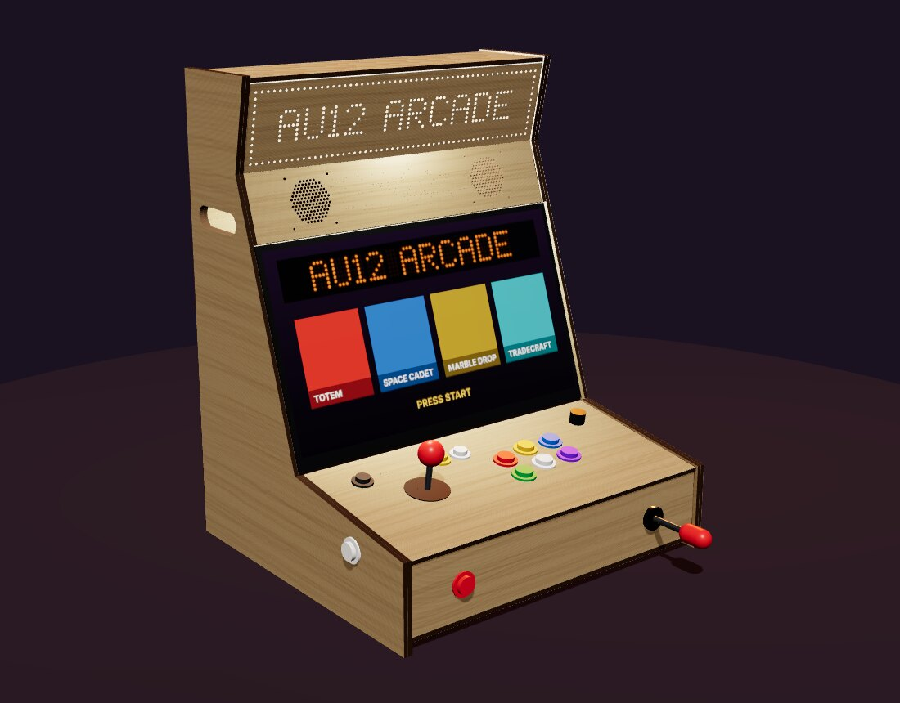
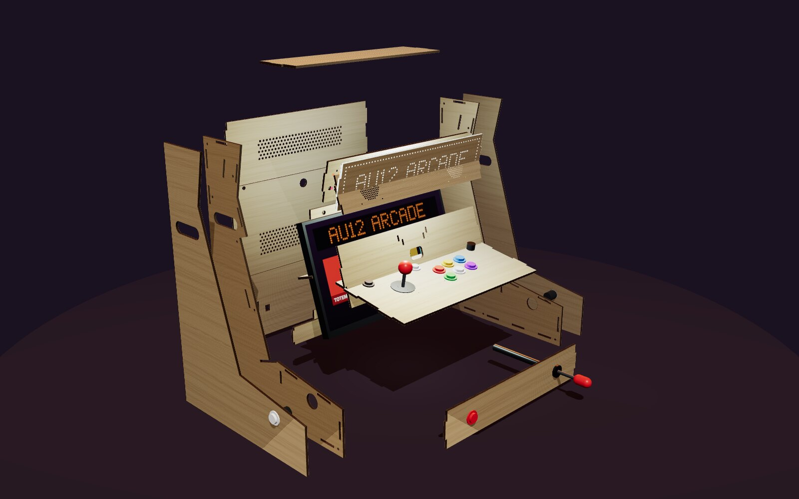
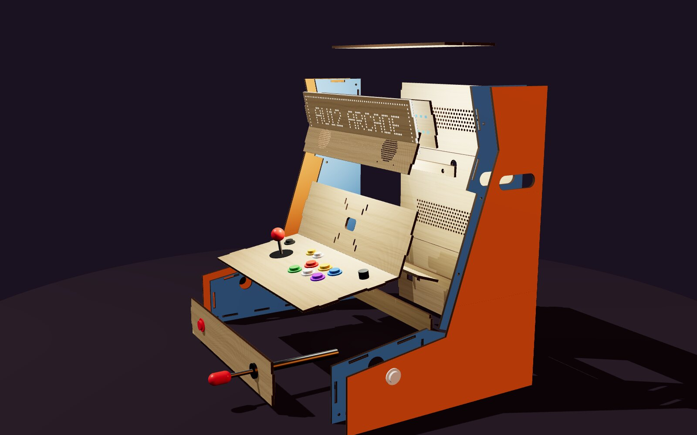
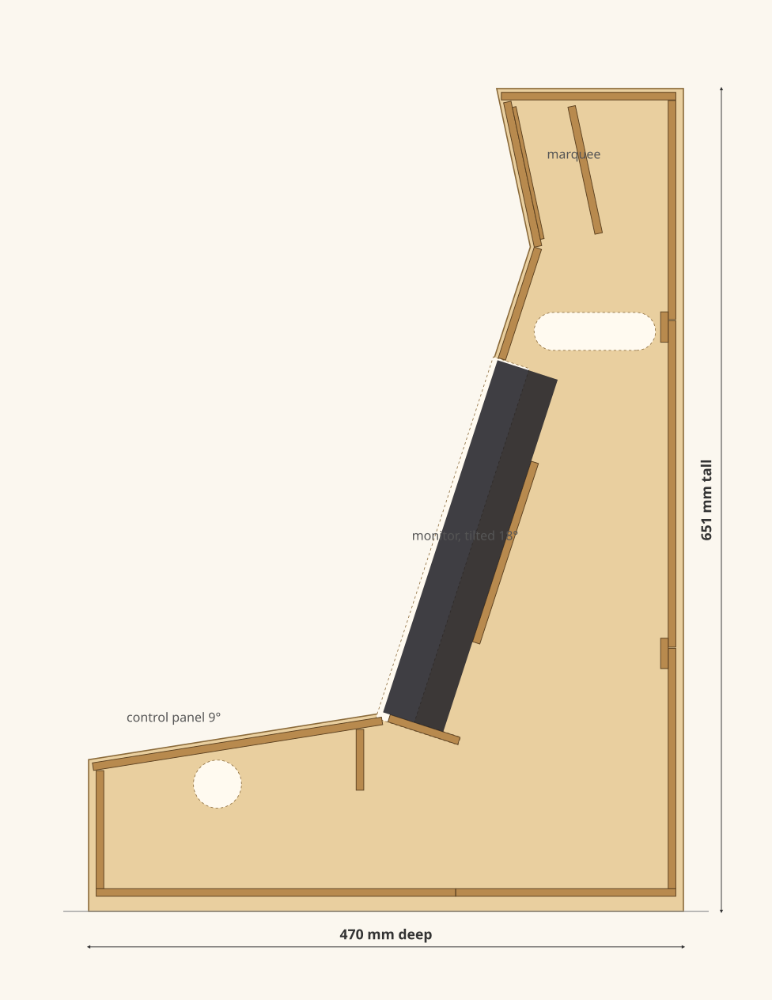
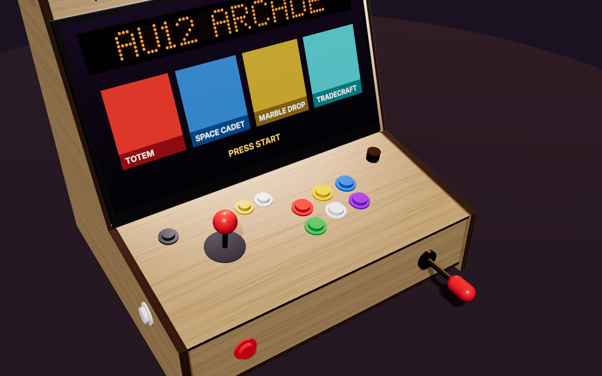
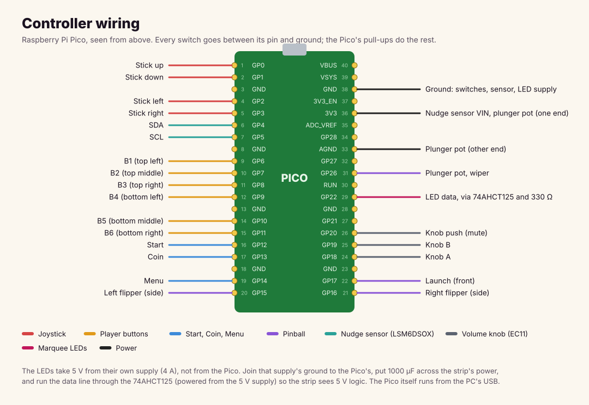

# The cabinet

A bartop arcade cabinet for the au12 Arcade, cut on a 12 × 20 inch laser from 6 mm plywood. It holds a 21.5" monitor, a mini PC running the arcade in kiosk mode, a stick and nine buttons laid out exactly like the control panel the arcade draws on screen, flipper buttons in the sides, a spring plunger and launch button for the pinball tables, speakers, and a marquee that lights up through its own dot-matrix lettering.



**[Turn it around in 3D](cut/21.5/viewer.html)** (download and open it in a browser; it's one self-contained file). Point at any part for its name, pull the slider to take it apart.

It is parametric: the cut files are generated from the monitor's size, the plywood's real thickness, your laser's kerf and bed, and a few angles. A different monitor or a thicker sheet is one command, not a redesign, and the generator checks its own work (no two parts in the same place, the monitor has room, every slot has wood around it, every part fits the bed) before it writes anything.

| | |
| --- | --- |
| Size | 510 wide × 470 deep × 651 tall (mm) |
| Wood | 15 sheets of 6 mm plywood, 12 × 20 in |
| Acrylic | 1 sheet of 3 mm opal (white translucent), for the marquee |
| Joints | Tab and slot, glued. Nothing shows on the outside. |
| Monitor | 21.5" 16:9 on a VESA 100 mount; others by regenerating |

## How it's built

Each side is two layers of plywood glued together. The inner layer carries a slot for every tab of every panel, so the outside of the cabinet shows no joints at all, and the two layers are split into pieces at different heights, so each piece is small enough for the laser and the seams of one layer are bridged by the other. Dowels in pockets that are engraved into the outer layer's hidden face line the layers up while the glue dries.





The panels between the sides: a floor (two pieces), the front with the launch button and plunger, the control panel with a beam under its back edge, a shelf the monitor stands on and a brace its VESA mount screws to, a speaker panel, the marquee and the board its LEDs sit on, the top, and a back with a door. The monitor goes in last, from the front, and screws to the brace from behind.



The control panel follows the arcade's own drawing (`ControlPanel` in [`web/src/components/game.jsx`](../web/src/components/game.jsx)), so what the arcade shows when it explains a game's controls is the panel under your hands: the stick on the left, six buttons in two staggered rows, Menu, Coin and Start along the top, the volume knob top right. Their names are engraved under them in the arcade's dot-matrix font.



## What's in here

| Path | |
| --- | --- |
| `cut/21.5/ply-01.svg` … `ply-15.svg` | The plywood, one file per sheet, laid out for a 508 × 305 mm bed |
| `cut/21.5/opal-01.svg` | The marquee's diffuser |
| `cut/21.5/test-fit.svg` | Cut this first (see below) |
| `cut/21.5/parts.csv` | Every part, its size and its sheet |
| `cut/21.5/profile.svg` | The side view, with the main dimensions |
| `cut/21.5/viewer.html` | The 3D model |
| `generate.mjs` | Makes all of the above |
| `docs/wiring.svg` | The controller's wiring |

In the SVGs: **red** is cut, **blue** is engraving (the control panel's labels, the marquee, *INSERT COIN*, *PLAYER 1*), **green** is part labels on faces that end up hidden (engrave them lightly, or delete the layer), and **magenta** is the dowel pockets (engrave about 2.5 mm deep). LightBurn turns each color into a layer when it imports the file.

## Your monitor, your plywood, your laser

```sh
cd cabinet
npm ci
node generate.mjs --list                       # the monitors it knows
node generate.mjs --monitor 19.5               # → cut/19.5/
node generate.mjs --ply 5.8 --kerf 0.18        # your measured plywood and kerf
node generate.mjs --bed 500x300                # a 300 × 500 mm work area
node generate.mjs --monitor.w 488 --monitor.h 287 --monitor.vesaDepth 44 --out cut/mine
node generate.mjs --holes.button 30            # 30 mm screw-in buttons instead of 1-1/8"
node build-viewer.mjs cut/mine                 # the 3D view of your version
```

Measure the plywood with calipers in a few places and use the average: "6 mm" Baltic birch is anything from 5.6 to 6.4. For a monitor it doesn't know, give its body's width and height (without the stand), `vesaDepth` (from the screen to the VESA mounting face), `edge` (how thick its left and right ends are), `vesaY` (from the bottom edge to the middle of the VESA holes) and the lit area (`viewW`, `viewH`, `viewBottom`). Every other option is in [`lib/design.mjs`](lib/design.mjs), with what it does.

If a check fails, the generator says which and stops with a non-zero exit, so a monitor that's too wide for your bed is a message, not a ruined sheet.

## What you need

**Wood and plastic**

- 15 sheets of 6 mm Baltic birch plywood, 12 × 20 in. Buy 18: something always goes wrong once.
- 1 sheet of 3 mm opal acrylic, 12 × 20 in.
- About 300 mm of 6 mm hardwood dowel, cut into 16 pins 8 mm long.
- Wood glue (Titebond II or similar), and a few dabs of clear silicone for the diffuser.

**For the cabinet**

- A 21.5" monitor with VESA 100 or 75 holes (its stand comes off), 4 × M4 × 12 screws and 4 nylon spacers.
- A mini PC (an Intel N100 box is plenty) for the arcade in kiosk mode: see [`kiosk/`](../kiosk/).
- 2 × 3" (78 mm square frame) full-range speakers, 8 × M3 × 12 screws and nuts, and a small stereo amplifier (a USB-powered PAM8403 or TPA3116 board).
- A 3-in-1 IEC power inlet (socket, fuse and switch; 28 × 48 mm cutout) and a short power strip inside.
- A keystone USB coupler, for a keyboard on the back without opening anything.
- 2 × 10 × 3 mm magnets and 2 more (or steel washers) for the back door.
- 4 small rubber feet, at most 12 mm across: the sides are what stands on the table.

**Controls and the controller** (the [controller's README](../controller/README.md) has part numbers): an 8-way stick, seven 1-1/8" (28.6 mm) screw-in buttons (six on the panel, red Launch on the front), three 24 mm buttons (Menu, Coin, Start), two flipper buttons, a pinball plunger and a 60 mm slide potentiometer, an EC11 rotary encoder with a knob, an LSM6DSOX accelerometer board, a Raspberry Pi Pico, 1 m of 60 LED/m WS2812B strip, a 74AHCT125, a 5 V 4 A power supply, wire and 2.8 mm quick-disconnects.

## Cutting

1. **Cut `test-fit.svg` first.** It has five slots from 0.1 mm tight to 0.3 mm loose, a tab to try in each, and the button and knob holes. The slot that grips the tab firmly by hand is your fit: if it's the `+.2` one, regenerate with `--fit 0.2`. If none grips, measure the plywood again and pass `--ply`.
2. Starting points for a 50 W tube on 6 mm birch with air assist (test them on the coupon): cut at 10–14 mm/s and 85–95 % in one pass; engrave (blue) at 250–350 mm/s and 20–30 %; labels (green) lighter still; pockets (magenta) as a fill, three or four passes until a dowel stands 2.5 mm deep in one. The acrylic cuts at about 8–12 mm/s and 60–70 %; leave its protective film on.
3. Cut the sheets. Leave the side pieces on their sheets' labels so the left and right don't get mixed up: every side piece is labeled (`LEFT-OUTER-2`…), on the face that ends up glued.

## Putting it together

1. **Laminate the sides**, one at a time, on a flat table. Lay the outer pieces down labeled face up, with their edges together. Glue a dowel pin into each pocket. Spread glue thinly, avoiding a 10 mm margin round every slot, and press the inner pieces on, labeled face down, onto the dowels. The seams don't line up, and that's the point. Weigh the whole side down flat for an hour. Check the two sides are mirror images, slots facing each other.
2. **Mount what goes on the panels before the panels go in.** Buttons, stick and knob in the control panel; the launch button and plunger in the front; speakers on the speaker panel; the LED strip on the LED board in two rows (zip ties through the slots; wire it as one strip that snakes back along the second row); the IEC inlet and the USB coupler in the lower back. Glue the opal diffuser behind the marquee with a few dabs of silicone, keeping it clear of the marquee's edges, which go into the slots.
3. **Wire the controls** to the Pico while you can reach everything: see the [wiring](#wiring).
4. **Dry fit.** Lay one side down, slots up. Stand every panel in its slots: the two floor pieces, the front, the control-panel beam, the control panel, the monitor shelf, the VESA brace, the speaker panel, the marquee, the LED board, the top, and the upper and lower back. Lower the other side on, guiding the tabs in as it goes. A tight tab takes a tap with a mallet and a block of wood.
5. **Glue it.** Take it apart one side at a time, glue the slots, and put it back. Strap it, check it's square (the diagonals of the front opening match), and leave it overnight. Glue the two door stops to the inside of the back rails, with the magnets in the top one, and the matching magnets into the door.
6. **The monitor goes in from the front.** Take its stand off, tilt it into the opening above the control panel and slide it back along the shelf until it meets the brace. Then, from behind through the door, put the four M4 screws through the brace's slots into its VESA holes. The slots give ±6 mm of play and take a 75 or a 100 mounting; if the monitor's VESA face sits lower than its back, make up the gap with the nylon spacers.
7. **Inside**: the mini PC and the power strip on the floor behind the control box, the amplifier and the LED supply beside them, the Pico on the floor of the control box. Then follow [`kiosk/`](../kiosk/) to make the PC boot straight into the arcade.

## Wiring



Every switch has one leg on its Pico pin and the other on a ground wire that runs from switch to switch. The full story (the plunger's calibration, the nudge sensor's mounting, flashing the firmware) is in [`controller/`](../controller/README.md).

## Finishing

Sand the faces lightly (240 grit) before the lacquer: laser smoke rinses off the tops of the sheets with a damp cloth, and the dark laser-cut edges are part of the look. Two coats of water-based satin lacquer or hardwax oil, avoiding the slots. The marquee and speaker grilles look best left natural.

## How the generator works

[`lib/design.mjs`](lib/design.mjs) works out the side profile from the angles and the monitor (control panel, screen, speaker band, marquee, top, back), places every panel against it as a strip with tabs, cuts the matching slots in the inner layer, the monitor's recess (open at the face, so no thin strips are left in front of it) and the shelf's notch, splits each layer into bed-sized pieces at heights that keep clear of slots and of the shallow control-panel edge, picks dowel spots that each piece shares with a piece of the other layer, and then runs its checks. [`lib/nest.mjs`](lib/nest.mjs) packs the parts onto sheets (MaxRects), and [`lib/svg.mjs`](lib/svg.mjs) writes them, sizing slots and holes for the kerf. The viewer ([`viewer/main.js`](viewer/main.js), three.js) extrudes the same outlines and places them with the same frames.
